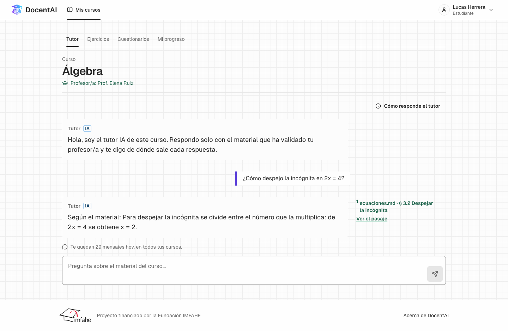
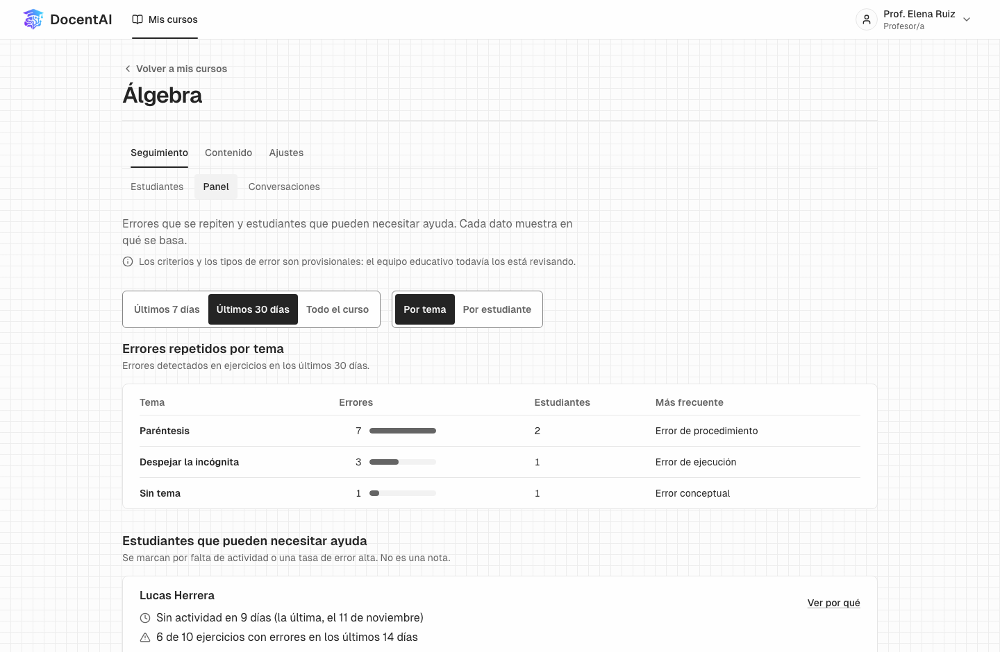
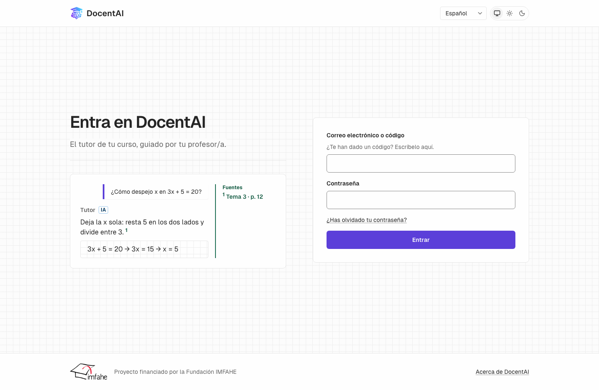

<p align="center">
  
</p>

<p align="center">
  <a href="https://github.com/DocentAI-Org/frontend/actions/workflows/ci.yml"></a>
  <a href="LICENSE"></a>
</p>

# DocentAI Frontend

DocentAI is a teacher-guided AI tutor. The teacher uploads and validates the course material; the
tutor answers students **only** from that material, cites the document and section of every answer,
and says plainly when the material does not cover a question. Beyond answering, it gives feedback
on worked exercises, notices recurring mistakes, adapts quizzes to each student, and shows the
teacher where the class is struggling. It works for any subject, from secondary-school maths to
university courses.

This repository is the Next.js 16 (App Router) web app: students chat with the tutor, submit
exercises, take quizzes and follow their progress; teachers manage courses, material, tutor
settings and corrections, and follow their class; admins manage accounts. It talks to the DocentAI
API v1 ([`DocentAI-Org/backend`](https://github.com/DocentAI-Org/backend)) and uses Supabase Auth
for sessions. Spanish is the pilot language; English is complete for every feature.

<picture>
  <source media="(prefers-color-scheme: dark)" srcset="docs/images/student-chat-dark.png">
  
</picture>

<table>
  <tr>
    <td width="50%">
      <picture>
        <source media="(prefers-color-scheme: dark)" srcset="docs/images/teacher-dashboard-dark.png">
        
      </picture>
    </td>
    <td width="50%">
      <picture>
        <source media="(prefers-color-scheme: dark)" srcset="docs/images/sign-in-dark.png">
        
      </picture>
    </td>
  </tr>
  <tr>
    <td align="center">Teacher dashboard</td>
    <td align="center">Sign-in</td>
  </tr>
</table>

The screenshots come from the typed mock backend used by the E2E tests (`tests/app/mock-api`),
with fictitious people.

The design system lives in the app: tokens in `src/app/theme.css`, described in `DESIGN.md`. The
static HTML prototype that guided the first screens is archived in the `archive/prototype` branch
(tag `prototype-final`).

## Getting started

```bash
npm install
cp .env.example .env.local   # then fill in the values below
npm run dev                  # http://localhost:3000
```

| Variable | Purpose |
|---|---|
| `NEXT_PUBLIC_SUPABASE_URL` | Supabase Auth URL (`http://127.0.0.1:54321` locally) |
| `NEXT_PUBLIC_SUPABASE_PUBLISHABLE_KEY` | `PUBLISHABLE_KEY` from `npx supabase status -o env` in the backend repo |
| `API_BASE_URL` | DocentAI API, called from the Next.js server only (`http://localhost:8000`) |
| `PSEUDONYM_EMAIL_DOMAIN` | Pseudonymous students sign in with a code; their auth email is `<code>@<domain>` |
| `STUDY_QUESTIONNAIRES` | `on` shows the study questionnaires card on "Mis cursos"; hidden otherwise (off for now) |
| `PRIVACY_CONTACT_EMAIL` | Contact shown on `/about` |
| `DEMO_MODE` | `on` runs the demo: no backend needed (see below); the variables above are then ignored except the last three |

To run against the real backend, start it as described in its README (Supabase, Ollama,
`uvicorn`, `scripts/seed_dev.py`).

### Demo mode

`DEMO_MODE=on npm run dev` runs the app with no backend: its API and Auth calls are answered in
process by the typed mock of the E2E tests (`tests/app/mock-api/demo.ts`), loaded with a sample
algebra course, a student's activity and a quiz bank. The sign-in page lists the sample accounts
with one-click buttons, and a notice on every page says the data is fictitious. Changes live in
the server's memory: every visitor sees them, and the data starts over every hour (and whenever
the server restarts).

## Scripts

| Command | What it does |
|---|---|
| `npm run dev` / `build` / `start` | Next.js development server, production build, production server |
| `npm run lint` · `npm run typecheck` | ESLint (with SonarJS rules) · route types and TypeScript |
| `npm run knip` | Unused files, exports and dependencies |
| `npm run test` | Unit and component tests (Vitest + Testing Library, `tests/app/unit`) |
| `npm run test:e2e:app` | App E2E with axe (Playwright, desktop 1440 px and mobile 390 px) against the typed mock backend in `tests/app/mock-api`; starts the mock and the app itself |
| `npm run test:e2e:integration` | The same suite against the real local stack and an app started with `npm run dev` |
| `npm run test:e2e:demo` | Demo mode E2E with axe (`tests/app/demo`); starts the app with `DEMO_MODE=on` |
| `npm run api:types` · `api:check` | Regenerate / check `src/lib/api/schema.d.ts` from the pinned contract `contracts/backend-openapi.json` |

## Structure

```text
src/
├── proxy.ts            # Supabase session refresh, signed-out redirect to /sign-in
├── lib/api/            # typed API client (server-only), one module per area
├── lib/auth/           # Supabase server client, role guards, sign-in identifiers
├── components/         # design system components (AppShell, StudentShell, …)
└── app/                # (public), (student), (teacher), (admin) route groups
messages/es.json · en.json   # ES and EN catalogs (next-intl)
contracts/backend-openapi.json  # the backend contract the API types are generated from
```

## Deployment (Vercel)

The project deploys to Vercel as a Next.js app; build settings live in `vercel.ts` (install with
`npm ci`, build with `npm run build`). Every response carries `X-Robots-Tag: noindex`.

Until the backend is deployed, the deployment runs in demo mode: set `DEMO_MODE=on` for
Preview and Production. Once there is a backend, remove it and set the variables above instead.

One-time setup:

1. In the Vercel dashboard, import the `DocentAI-Org/frontend` GitHub repository
   (framework preset: Next.js, root directory: repository root).
2. Check Settings → Deployment Protection. If previews require a Vercel login, create a
   shareable link or a protection bypass before sharing a preview with session participants.

After that, every push gets a preview URL and every merge to
`main` deploys to production.

## Use of Generative AI

DocentAI is developed with AI coding agents, mostly Claude, under the guidance of the team. The
specifications, agent configuration and evaluation tools live in a separate repository and evolve
with the project; they are not a validated methodology for agentic software development.

Every change goes through AI code review and the checks above: ESLint with SonarJS rules, knip,
type checking, the API contract check, unit tests and E2E tests with axe accessibility checks,
plus CodeQL on every pull request. Even so, the code may contain the usual issues of AI-generated
code, and bugs that will be fixed as they are found.

## Disclaimer

DocentAI is a research prototype under development, not a commercial product. It is provided
"as is", without warranty of any kind, as stated in its [license](LICENSE). Its answers come from a
language model and can be wrong even when they cite the material; teachers remain responsible
for the material they validate and for how the tutor is used in their courses. Never load real
student data into a development or test environment.

## Acknowledgements

<a href="https://imfahe.org"></a>

DocentAI is funded by the [IMFAHE Foundation](https://imfahe.org) (International Mentoring
Foundation for the Advancement of Higher Education) through the IMFAHE Global Idea Competition –
Shark Tank 2026. *Proyecto financiado por la Fundación IMFAHE.*

## Team

| Member | Area |
|---|---|
| Miguel Romero | Product and development |
| Denisa-Andreea Constantinescu | Infrastructure and security |
| Génesis M. De León | Pedagogy |
| Laura M. Ezama | Study design and ethics |
| Mariano Soler | Finance and sustainability |

## License

Apache License, Version 2.0. See [LICENSE](LICENSE) and [NOTICE](NOTICE). The IMFAHE logo is a
trademark of the IMFAHE Foundation and is not covered by this license.
